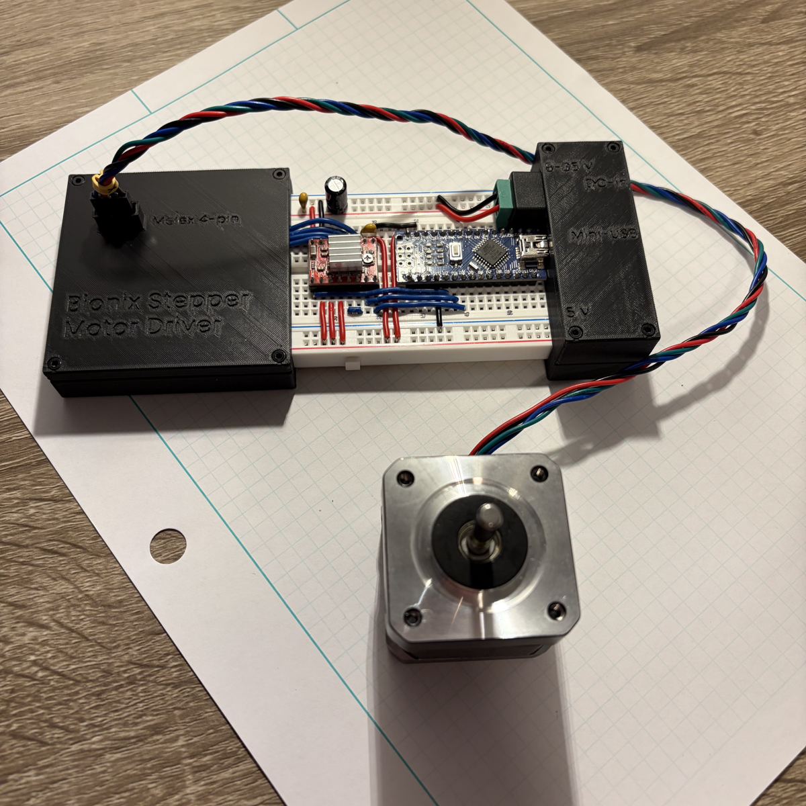
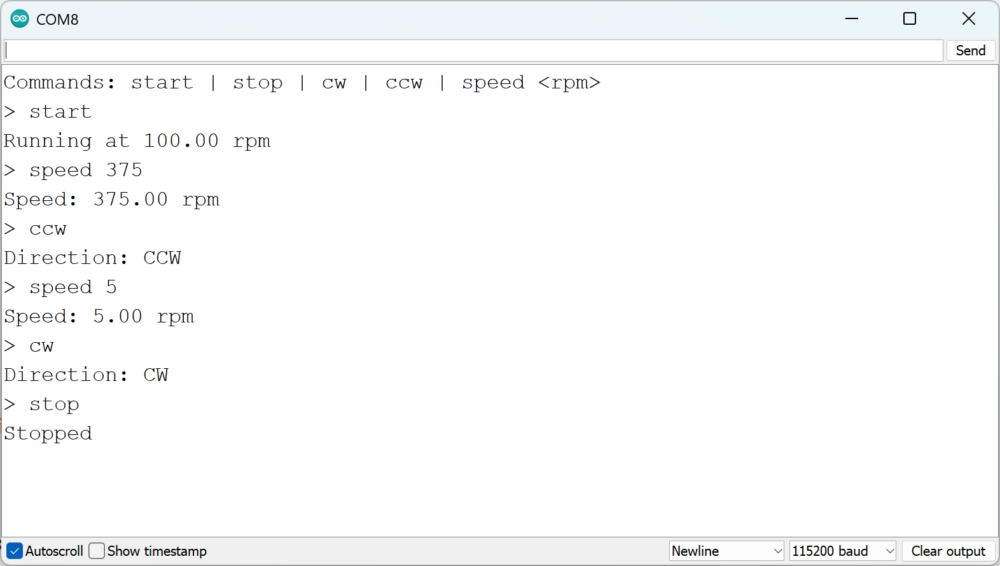

# Bionix Stepper Motor Driver

USB serial control of a NEMA 17 stepper motor through an Arduino Nano and an A4988 driver.

| Directory | Content |
|---|---|
| `firmware/` | Arduino firmware source |
| `solidworks/` | Enclosure CAD |
| `images/` | Figures |

## 1 Safety

> **WARNING:** The motor starts as soon as `start` is sent. Keep hands clear of the transmission, and send `stop` before reaching in.

> **CAUTION:** The motor and the driver heatsink get hot. Let them cool before touching them.

> **CAUTION:** After `stop`, the motor has no holding torque, so a load can backdrive it.

> **NOTICE:** Connect or disconnect the motor only while the DC supply is removed.

> **NOTICE:** Use only a centre-positive DC supply between 8 V and 35 V.

- Missed steps and stalls are not detected.
- The motor keeps running if the computer disconnects. Do not leave the device running unattended.

## 2 Specifications

| Parameter | Value |
|---|---|
| Motor supply | 8 V to 35 V DC, 5.5 mm × 2.1 mm barrel jack, centre-positive |
| Logic supply | 5 V over Mini-USB |
| Speed range | 5 rpm to 375 rpm |
| Microstepping | 1/16 (3200 microsteps per revolution) |
| Serial | 115200 baud, 8N1 |

## 3 Setup

1. Connect the motor to the Molex 4-pin connector.
2. Connect the DC supply to the DC-in jack.
3. Connect the Mini-USB port to the computer.
4. In the Arduino IDE, open Tools > Serial Monitor and select the Nano's COM port.
5. Set the baud rate to 115200 and the line ending to "Newline".

Result: The Serial Monitor shows `Commands: start | stop | cw | ccw | speed <rpm>`.

- If the Nano has no firmware, upload `firmware/firmware.ino` with Tools > Board > Arduino Nano. If the upload fails, select Tools > Processor > ATmega328P (Old Bootloader).

## 4 Operation

| Command | Effect |
|---|---|
| `start` | Starts the motor at the set speed. |
| `stop` | Stops the motor and removes coil power. |
| `cw` | Sets the direction to clockwise. |
| `ccw` | Sets the direction to counter-clockwise. |
| `speed <rpm>` | Sets the speed in rpm. |

- Commands are not case-sensitive and take effect immediately, including while running.
- At power-up the motor is off, the direction is CW, and the speed is 100 rpm.
- Speeds outside 5 rpm to 375 rpm are clamped to the nearest limit.
- Above about 200 rpm, start at a lower speed and raise it in steps to avoid a stall.
- Reduce the speed before reversing direction.
- Opening the Serial Monitor resets the Nano, which stops the motor and restores the defaults.

## 5 Troubleshooting

| Symptom | Remedy |
|---|---|
| No response in the Serial Monitor | Check the COM port, 115200 baud, and "Newline". |
| `Unknown command` or `Usage: speed <rpm>` | Check the command spelling and send a positive speed. |
| Motor does not turn after `start` | Check that the DC supply is connected and on. |
| Motor hums without turning | Send `stop`, lower the speed, and send `start`. |
| Motor stops when the Serial Monitor opens | Send `start` again. |
