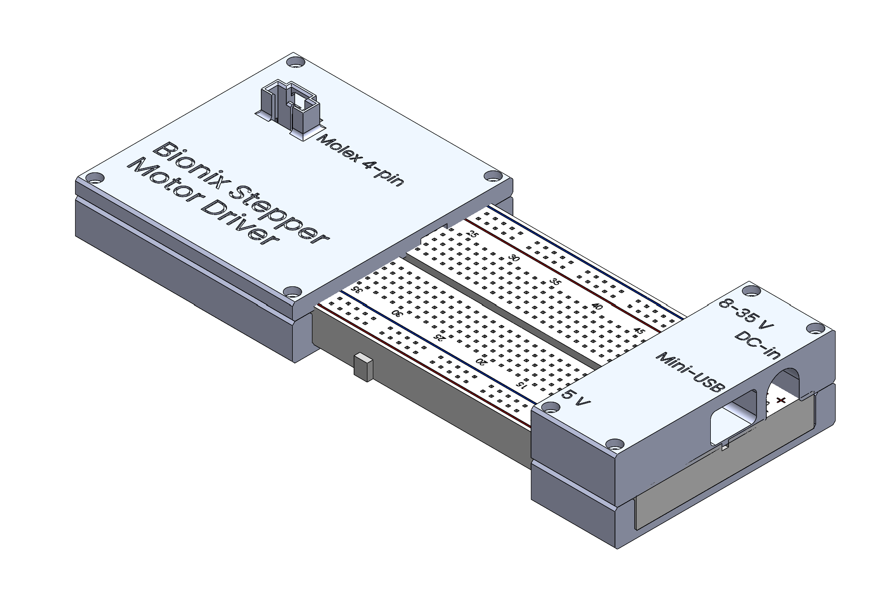
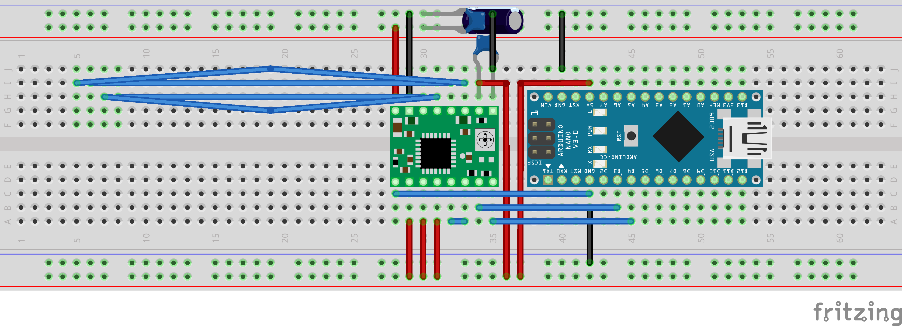

# Bionix Stepper Motor Driver: Instructions for Use

**Figure 1.** Assembled driver with the motor connected.

## Contents

1. [Identification](#1-identification)
2. [About this document](#2-about-this-document)
3. [Safety](#3-safety)
4. [Intended use](#4-intended-use)
5. [Product description](#5-product-description)
6. [Transport and storage](#6-transport-and-storage)
7. [Assembly](#7-assembly)
8. [Installation and commissioning](#8-installation-and-commissioning)
9. [Operation](#9-operation)
10. [Troubleshooting](#10-troubleshooting)
11. [Maintenance](#11-maintenance)
12. [Decommissioning and disposal](#12-decommissioning-and-disposal)
13. [Reference information](#13-reference-information)
14. [Commissioning record](#14-commissioning-record)
15. [Document revision history](#15-document-revision-history)

## 1 Identification

| Item | Value |
|---|---|
| Product name | Bionix Stepper Motor Driver |
| Product type | Open-loop stepper motor controller with USB serial control |
| Hardware revision | Rev A |
| Firmware | `serial_stepper.ino`, version 1.0 |
| Supplier | Simon, Bionix team |
| Document version | 1.1 |
| Document date | 2026-09-29 |

- This document applies only to the hardware revision and firmware version listed above.
- Keep this document with the product and pass it on to any subsequent user.

## 2 About this document

### 2.1 Target audience

- This document is written for Bionix team members working on the transmission build.
- Readers are expected to be able to use the Arduino IDE, a multimeter, a small screwdriver, and a soldering iron.
- No prior knowledge of stepper motor drivers is assumed.

### 2.2 Safety message format

Safety messages in this document follow the format of ISO 3864-2.

| Signal word | Meaning |
|---|---|
| **WARNING** | A hazardous situation that could result in serious injury if not avoided. |
| **CAUTION** | A hazardous situation that could result in minor or moderate injury if not avoided. |
| **NOTICE** | A situation that could result in damage to the product or the transmission if not avoided. |

### 2.3 Conventions

- Text in `code format` is a command typed into the Serial Monitor, an identifier in the firmware, or a file in this repository.
- Numbered steps are carried out in the order given.
- A line starting with "Result:" describes what the user observes after a step.
- "Left" and "right" refer to the housings as shown in Figure 1, with the motor housing on the left and the power housing on the right.
- Terms are defined in Section 13.5.

### 2.4 Repository contents

| Path | Content |
|---|---|
| `README.md` | This document |
| `serial_stepper/serial_stepper.ino` | Firmware source |
| `solidworks/assembly.SLDASM` | Enclosure assembly |
| `solidworks/left_top.SLDPRT`, `solidworks/left_bottom.SLDPRT` | Motor housing halves |
| `solidworks/right_top.SLDPRT`, `solidworks/right_bottom.SLDPRT` | Power housing halves |
| `solidworks/breadboard.SLDPRT` | Breadboard reference model |
| `images/` | Figures used in this document |

## 3 Safety

### 3.1 General safety information

> **WARNING: Rotating parts.** The motor shaft and the transmission can start moving as soon as `start` is sent. Clothing, hair, or fingers caught in the transmission can be pulled in. Keep hands clear of the transmission before sending `start`, and send `stop` before reaching in.

> **CAUTION: Hot surfaces.** The motor body and the A4988 heatsink become hot during operation. Touching them can cause burns. Let them cool for several minutes after `stop` before touching them.

> **CAUTION: Hot tools.** Heat-set inserts are installed with a soldering iron. The iron tip and the insert can cause burns. Do not touch an insert until it has cooled.

> **CAUTION: Unexpected movement after stop.** Sending `stop` removes power from the motor coils, so the motor has no holding torque. A load on the transmission can backdrive the motor. Secure the load mechanically before relying on the motor to hold position.

> **NOTICE: Connector damage.** Connecting or disconnecting the motor while motor power is applied can destroy the A4988 driver. Remove the DC supply before connecting or disconnecting the motor.

> **NOTICE: Supply limits.** A supply above 35 V, or a supply with reversed polarity, destroys the A4988 driver. Use only a centre-positive DC supply between 8 V and 35 V.

> **NOTICE: Electrostatic discharge.** The Nano and the A4988 are sensitive to static discharge. Touch a grounded metal object before handling the exposed breadboard.

### 3.2 Residual risks

- The system is open-loop, so a stalled or skipped motor is not detected and no error is reported.
- The firmware has no acceleration ramp, so a high commanded speed can stall the motor at start.
- The firmware has no timeout, so the motor keeps running if the computer disconnects or the Serial Monitor is closed without sending `stop`.
- The breadboard is exposed between the housings, so a loose metal object can short the supply rails.

## 4 Intended use

### 4.1 Intended use

- The product drives the stepper motor on the transmission build during mechanical development.
- The product is an interim drive for use until the BLDC motor and its controller are functional.
- The product is operated by one attended user over USB from a computer.

### 4.2 Reasonably foreseeable misuse

- Do not use the product for position control, because missed steps are not detected.
- Do not leave the product running unattended.
- Do not use the product as the final drive for the transmission.
- Do not drive a motor rated above 2 A per coil, because this exceeds the A4988 rating.
- Do not power the Nano from the motor supply, because Rev A does not route the motor supply to the Nano.

## 5 Product description

### 5.1 Overview

- The product converts speed and direction commands received over USB into step pulses for a bipolar stepper motor.
- An Arduino Nano generates the step pulses and an A4988 driver module powers the motor coils.
- The electronics are built on a full-size solderless breadboard.
- A 3D-printed housing encloses each end of the breadboard and carries the external connectors.

### 5.2 Components

**Figure 2.** Enclosure CAD assembly with the motor housing on the left and the power housing on the right.

| Component | Description |
|---|---|
| Controller | Arduino Nano Rev3 (ATmega328P, 16 MHz) |
| Driver | Pololu A4988 driver module with heatsink |
| Motor | Prusa MK3 X-axis motor (Prusa part 2042-000013) |
| Motor housing | Left 3D-printed housing carrying the Molex 4-pin motor connector |
| Power housing | Right 3D-printed housing exposing the DC-in jack and the Mini-USB port |
| Bulk capacitor | 100 µF electrolytic capacitor across the motor supply |
| Ceramic capacitors | Two 100 nF ceramic capacitors for high-frequency decoupling |

### 5.3 Interfaces

| Interface | Location | Function |
|---|---|---|
| DC-in jack | Power housing | Motor supply input, 8 V to 35 V DC, 5.5 mm × 2.1 mm, centre-positive |
| Mini-USB port | Power housing | Serial control and Nano power |
| Molex 4-pin connector | Motor housing | Motor coil connection |

- The "5 V" marking on the power housing identifies the breadboard rail that carries the 5 V logic supply.
- The "5 V" marking is a rail label and not a connector.

### 5.4 Technical data

| Parameter | Value |
|---|---|
| Motor supply voltage | 8 V to 35 V DC |
| Logic supply | 5 V from the Nano, powered over USB |
| Motor | NEMA 17, bipolar, $1.8^\circ$ per full step, 1 A rated current |
| Microstepping | 1/16 (3200 microsteps per revolution) |
| Speed range | 5 rpm to 375 rpm |
| Default speed at power-up | 100 rpm |
| Control interface | USB serial, 115200 baud, 8N1 |
| Motor connector | Molex 50-57-9404 |
| DC-in connector | Barrel jack, 5.5 mm outer diameter, 2.1 mm pin |
| Housing material | PLA |

## 6 Transport and storage

1. Send `stop`, then disconnect the DC supply and the USB cable.
2. Disconnect the motor at the Molex connector.
3. Keep the breadboard assembly flat so that no jumper wires are pulled out.
4. Store the product dry and away from loose metal parts that could short the exposed breadboard.
5. Store the product below about 50 °C, because PLA housings soften above this temperature.

## 7 Assembly

This section applies when building a new unit or rebuilding a damaged one.

### 7.1 Parts list

The reference designators match the Fritzing breadboard file.

| Ref. | Qty | Part | Specification |
|---|---|---|---|
| Part1 | 1 | Arduino Nano | Rev3, ATmega328P, Mini-USB |
| Pololu A1 | 1 | Stepper driver module | Pololu A4988, with heatsink |
| C1 | 1 | Electrolytic capacitor | 100 µF, 50 V |
| C2, C3 | 2 | Ceramic capacitor | 100 nF |
| | 1 | Solderless breadboard | Full size, 830 tie points |
| | 1 | DC jack adapter | Female barrel jack, 5.5 mm × 2.1 mm, with screw terminals |
| | 1 | Motor connector | Molex 4-pin, 50-57-9404 |
| | 1 set | Jumper wires | Solid-core, 22 AWG |
| | 1 | Stepper motor | Prusa 2042-000013 |
| | 1 | Motor housing top | `left_top`, printed in PLA |
| | 1 | Motor housing bottom | `left_bottom`, printed in PLA |
| | 1 | Power housing top | `right_top`, printed in PLA |
| | 1 | Power housing bottom | `right_bottom`, printed in PLA |
| | 8 | Heat-set insert | M2, 3 mm long, 3.5 mm outer diameter |
| | 4 | Screw | M2 × 8 mm, for the motor housing |
| | 4 | Screw | M2 × 16 mm, for the power housing |

### 7.2 Tools and materials

- A 3D printer and PLA filament are needed to print the housings.
- A soldering iron with a heat-set insert tip is needed to install the inserts.
- A screwdriver matching the M2 screw heads is needed to close the housings.
- A multimeter is needed to set the current limit in Section 8.2.

### 7.3 Print the housings

1. Open each of the four housing parts in SolidWorks.
2. Export each part to STL or 3MF.
3. Print each part in PLA.

Result: Four housing halves are available, two for each side.

### 7.4 Install the heat-set inserts

> **CAUTION: Hot tools.** Do not touch an insert until it has cooled.

1. Place an M2 insert on each of the four screw holes in `left_bottom`.
2. Press each insert in with the soldering iron until its top is flush with the mating face.
3. Repeat steps 1 and 2 for the four screw holes in `right_bottom`.
4. Let the parts cool before fitting screws.

Result: Each bottom half holds four flush M2 inserts.

### 7.5 Build the circuit

**Figure 3.** Breadboard layout. The upper rail pair carries the motor supply and the lower rail pair carries the 5 V logic supply.

> **NOTICE: Driver orientation.** Inserting the A4988 module rotated by $180^\circ$ destroys it when power is applied. Place the module with the potentiometer in the position shown in Figure 3.

> **NOTICE: Capacitor polarity.** Reversing C1 destroys it. Connect the lead next to the stripe on the capacitor body to the GND rail.

1. Place the Nano and the A4988 module on the breadboard as shown in Figure 3.
2. Place C1 and one 100 nF capacitor across the motor supply rails next to the A4988.
3. Place the second 100 nF capacitor across the A4988 VDD and GND pins.
4. Place the jumper wires as listed in Section 13.1.
5. Wire the Molex connector to the breadboard columns under the motor housing, as shown by the long jumpers in Figure 3.
6. Connect the red wire of the DC jack adapter to the motor supply positive rail and the black wire to the motor supply negative rail.
7. Check every connection against Section 13.1 before applying power.

Result: The circuit matches Figure 3 and Section 13.1.

### 7.6 Close the housings

1. Seat the left end of the breadboard in `left_bottom`.
2. Seat the Molex connector in the cutout in `left_top` and place `left_top` on `left_bottom`.
3. Fasten `left_top` with four M2 × 8 mm screws.
4. Seat the right end of the breadboard in `right_bottom` with the Mini-USB port and the DC jack aligned to their cutouts.
5. Place `right_top` on `right_bottom`.
6. Fasten `right_top` with four M2 × 16 mm screws.

Result: The unit matches Figure 1 and Figure 2.

## 8 Installation and commissioning

### 8.1 Connect the product

> **NOTICE: Connector damage.** Connect the motor before applying motor power.

1. Connect the motor cable to the Molex 4-pin connector on the motor housing.
2. Connect the DC supply to the DC-in jack.
3. Connect the Mini-USB port to the computer.

Result: The PWR LED on the Nano lights.

### 8.2 Set the current limit

The current limit must be set once before first use and again whenever the driver module is replaced.

> **NOTICE: Motor overheating.** A current limit above the motor rating of 1 A overheats the motor and the driver. Set the limit at or below 1 A.

The current limit is $I_{\max} = \dfrac{V_{\text{ref}}}{8 R_{cs}}$, where $R_{cs}$ is the sense resistor value printed on the driver module.

| Sense resistor marking | $R_{cs}$ | Target $V_{\text{ref}}$ for 1 A |
|---|---|---|
| R100 | $0.100\ \Omega$ | 0.80 V |
| R068 | $0.068\ \Omega$ | 0.54 V |
| R050 | $0.050\ \Omega$ | 0.40 V |

1. Read the marking on the two sense resistors next to the A4988 chip.
2. Set a multimeter to DC volts.
3. Place the positive probe on the metal top of the potentiometer and the negative probe on GND.
4. Turn the potentiometer with a plastic or ceramic screwdriver until the reading matches the target in the table.
5. Record the measured $V_{\text{ref}}$ and the sense resistor marking in Section 14.

### 8.3 Upload the firmware

This procedure is needed only if the Nano does not already run firmware version 1.0.

1. Open `serial_stepper/serial_stepper.ino` in the Arduino IDE.
2. Select Tools > Board > Arduino Nano.
3. Select Tools > Processor > ATmega328P.
4. Select the COM port of the Nano under Tools > Port.
5. Click Upload.
6. If the upload fails, select Tools > Processor > ATmega328P (Old Bootloader) and repeat step 5.

Result: The IDE reports "Done uploading".

### 8.4 Verify operation

1. Open Tools > Serial Monitor.
2. Set the baud rate to 115200.
3. Set the line ending to "Newline" or "Both NL & CR".

Result: The Serial Monitor shows `Commands: start | stop | cw | ccw | speed <rpm>`.

4. Keep hands clear of the transmission.
5. Send `start`.

Result: The motor turns at 100 rpm and the Serial Monitor shows `Running at 100.00 rpm`.

6. Send `stop`.

Result: The motor stops and the Serial Monitor shows `Stopped`.

## 9 Operation

> **WARNING: Rotating parts.** Keep hands clear of the transmission while the motor is running.

### 9.1 Commands

Commands are sent from the Serial Monitor and are not case-sensitive. The product echoes each command as `> <command>` before its response.

**Figure 4.** Example Serial Monitor session.

| Command | Effect | Response |
|---|---|---|
| `start` | Enables the driver and starts the motor at the set speed. | `Running at <rpm> rpm` |
| `stop` | Stops the motor and removes power from the coils. | `Stopped` |
| `cw` | Sets the direction to clockwise. | `Direction: CW` |
| `ccw` | Sets the direction to counter-clockwise. | `Direction: CCW` |
| `speed <rpm>` | Sets the motor speed in rpm. Decimal values are accepted. | `Speed: <rpm> rpm` |

### 9.2 Start the motor

1. Send `speed <rpm>` with the required speed.
2. Send `start`.

Result: The motor turns at the set speed.

- For speeds above about 200 rpm, start at a lower speed and raise it in steps to avoid a stall.

### 9.3 Change speed or direction

1. Send `speed <rpm>`, `cw`, or `ccw` while the motor is running.

Result: The change takes effect immediately without stopping the motor.

- Reversing direction at high speed can stall the motor. Reduce the speed before reversing.

### 9.4 Stop the motor

1. Send `stop`.

Result: The motor stops and has no holding torque.

### 9.5 Operating behaviour

- The motor is unpowered at power-up and remains unpowered until `start` is sent.
- The default direction at power-up is CW and the default speed is 100 rpm.
- Speeds below 5 rpm are set to 5 rpm and speeds above 375 rpm are set to 375 rpm.
- Opening the Serial Monitor resets the Nano, which stops the motor and restores the defaults.
- CW and CCW refer to the state of the DIR signal. The physical direction depends on the motor wiring and the viewing side.

## 10 Troubleshooting

| Symptom | Cause | Remedy |
|---|---|---|
| No response in the Serial Monitor | Wrong baud rate, port, or line ending | Set 115200 baud, the Nano's COM port, and "Newline" |
| `Unknown command` is shown | Command is misspelled | Check the spelling against Section 9.1 |
| `Usage: speed <rpm>` is shown | Speed value is missing, zero, or not a number | Send `speed` followed by a positive number |
| Motor does not turn after `start` | DC supply is off or disconnected | Connect a DC supply between 8 V and 35 V |
| Motor does not turn after `start` | Current limit is set too low | Set the current limit as in Section 8.2 |
| Motor hums or vibrates without turning | Motor has stalled at too high a speed | Send `stop`, lower the speed, and send `start` |
| Motor turns the wrong way | DIR state does not match the required direction | Send `cw` or `ccw` |
| Motor stops when the Serial Monitor is opened | The Nano resets on connection | Send `start` again |
| Motor runs intermittently and the driver is hot | Driver thermal shutdown from excess current | Lower the current limit as in Section 8.2 |
| Housing screw spins without tightening | Heat-set insert has pulled out | Reinstall the insert as in Section 7.4 |

## 11 Maintenance

- Check before each use that no breadboard jumper has been pulled out or displaced.
- Check before each use that the heatsink is still attached to the A4988.
- Check the current limit again after replacing the driver module, as in Section 8.2.
- Do not overtighten the housing screws, because this pulls the inserts out of the PLA.
- No other maintenance is required.

## 12 Decommissioning and disposal

1. Send `stop`, then disconnect the DC supply and the USB cable.
2. Disconnect the motor and return it to the transmission or parts stock.
3. Remove the housing screws and lift off both housing tops.
4. Remove the Nano and the A4988 from the breadboard for reuse.
5. Dispose of damaged electronic parts as electronic waste according to local regulations.
6. Dispose of the PLA housings according to local plastics recycling rules.

## 13 Reference information

### 13.1 Wiring

| A4988 pin | Connection |
|---|---|
| ENABLE | Nano D2 |
| STEP | Nano D3 |
| DIR | Nano D4 |
| MS1, MS2, MS3 | 5 V rail |
| RESET | Jumpered to SLEEP |
| SLEEP | Jumpered to RESET |
| VDD | Nano 5V |
| GND (logic) | Nano GND |
| VMOT | Motor supply positive rail |
| GND (motor) | Motor supply negative rail |
| 1A, 1B | Motor coil 1 via Molex connector |
| 2A, 2B | Motor coil 2 via Molex connector |

- The motor supply ground and the Nano ground are connected together.
- The Nano VIN pin is not connected.

### 13.2 Speed and step rate

- The motor makes $N = 200 \cdot 16 = 3200$ microsteps per revolution.
- The step rate for a speed $\omega$ in rpm is $f = \dfrac{N \omega}{60} = 53.\overline{3}\,\omega\ \text{Hz}$.
- The firmware toggles STEP every half-period $t_{1/2} = \dfrac{60 \times 10^6}{2 N \omega} = \dfrac{9375}{\omega}\ \mu\text{s}$.

| Speed (rpm) | Step rate (kHz) | Half-period ($\mu$s) |
|---|---|---|
| 5 | 0.27 | 1875 |
| 10 | 0.53 | 938 |
| 50 | 2.67 | 188 |
| 100 | 5.33 | 94 |
| 200 | 10.7 | 47 |
| 300 | 16.0 | 31 |
| 375 | 20.0 | 25 |

- The timing resolution of the Nano is $4\ \mu\text{s}$, so the speed error rises with speed and reaches up to about 16% at 375 rpm.
- Available torque falls with speed, and a higher supply voltage within 8 V to 35 V increases torque at high speed.

### 13.3 Firmware parameters

| Parameter | Value | Function |
|---|---|---|
| `STEP_PIN` | 3 | Nano pin driving A4988 STEP |
| `DIR_PIN` | 4 | Nano pin driving A4988 DIR |
| `ENABLE_PIN` | 2 | Nano pin driving A4988 ENABLE, active low |
| `MICROSTEPS_PER_REV` | 3200 | Microsteps per revolution at 1/16 microstepping |
| `MIN_RPM` | 5.0 | Lower speed limit |
| `MAX_RPM` | 375.0 | Upper speed limit |
| `DEFAULT_RPM` | 100.0 | Speed at power-up |

### 13.4 Related documents

| Document | Content |
|---|---|
| `serial_stepper/serial_stepper.ino` | Firmware source |
| `solidworks/assembly.SLDASM` | Enclosure CAD assembly (SolidWorks) |
| [Allegro A4988 datasheet](https://www.allegromicro.com/-/media/files/datasheets/a4988-datasheet.pdf) | Driver ratings and timing |
| [Pololu A4988 carrier](https://www.pololu.com/product/1182) | Driver module pinout and current limit procedure |
| Prusa 2042-000013 product page | Motor data |

### 13.5 Terms

| Term | Definition |
|---|---|
| Microstep | One sixteenth of a $1.8^\circ$ full step at 1/16 microstepping. |
| Open-loop | Operation without feedback of actual motor position or speed. |
| Holding torque | Torque the motor resists with when powered and not stepping. |
| Stall | Loss of synchronism in which the motor stops turning while being stepped. |
| $V_{\text{ref}}$ | Reference voltage on the A4988 potentiometer that sets the current limit. |
| Heat-set insert | Threaded brass insert pressed into a plastic part with heat. |

## 14 Commissioning record

| Item | Value |
|---|---|
| Sense resistor marking | |
| Measured $V_{\text{ref}}$ | |
| Resulting current limit | |
| Date set | |
| Set by | |

## 15 Document revision history

| Version | Date | Change |
|---|---|---|
| 1.0 | 2026-09-29 | First release, structured to IEC/IEEE 82079-1:2019 |
| 1.1 | 2026-09-29 | Added assembly section, parts list, fastener and insert specifications, and repository contents. Removed the 5 V port, which is a rail label. Updated figure paths and firmware path. |
